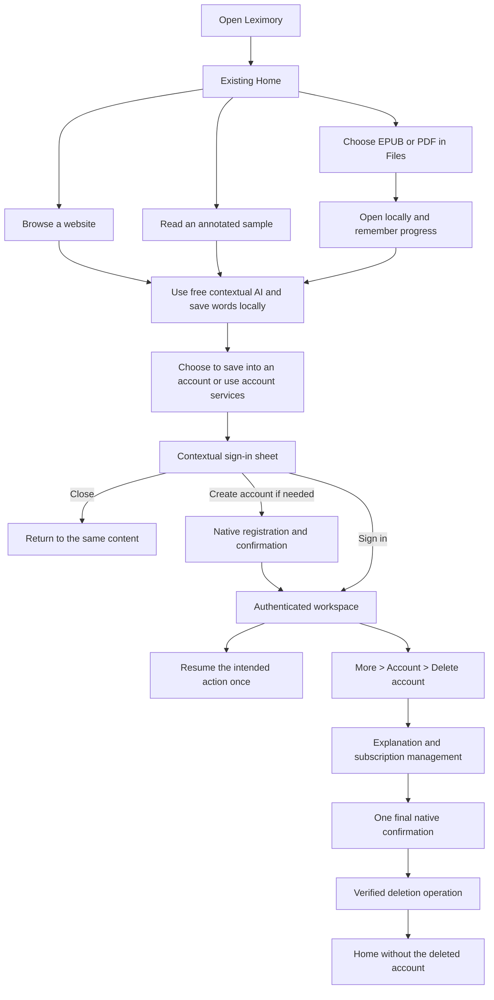
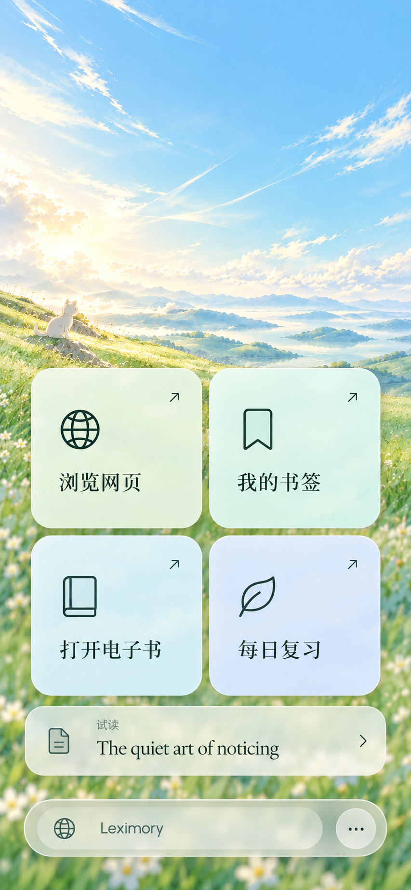
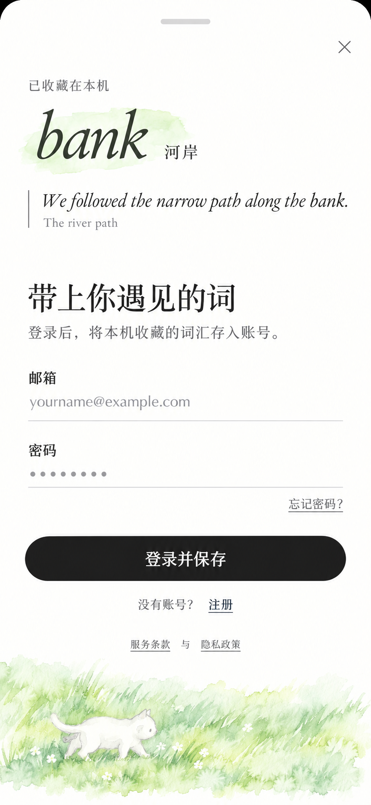
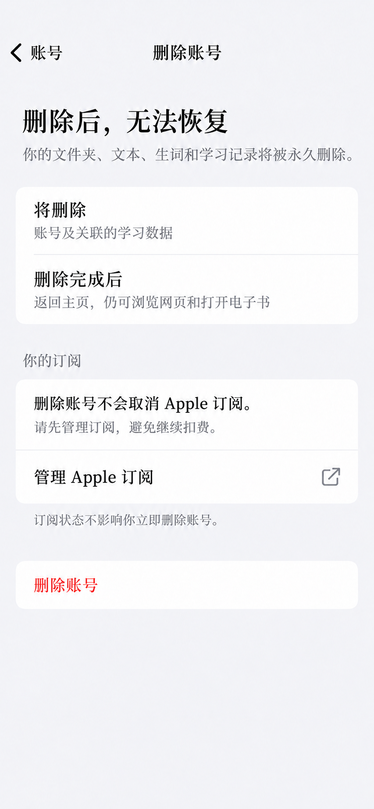

# Proposed account experience

Design and implementation plan only. The baseline keeps the browser workspace and four Home cards, adds local reading and free contextual AI, and moves authentication to cloud account actions. The [free-AI addendum](guest-ai.md) contains the current quota architecture and revised screen studies. Earlier sign-in images below are retained as a record and are superseded by that revision.

## Entry and onboarding

Remove WelcomeGate from the normal first-launch path. Preserve its artwork for an optional About page or later use. Do not add a carousel, language questionnaire, account-choice screen, permission primer, or a new "guest mode" label.

1. Start with the existing Home while restoring credentials in the background. If an existing account is restored, use its workspace. Never flash another account's content.
2. A genuinely signed-out installation stays on Home and can immediately browse or choose a file. No network request is required to establish a guest identity.
3. When there is no reading history, show one optional 试读 row below the four cards. It opens a bundled, rights-cleared article with real local annotations. After reading, it can appear as an ordinary recent item. No separate onboarding-completed flag is needed.
4. Let contextual AI and 收藏词汇 work without signup within the guest allowance. Ask for sign-in only after an explicit account action, or from More > 登录. Closing returns to the same reading position.

Restoration must distinguish an absent credential, an expired credential, and a temporary network failure. Existing cached account content should retain its established offline behavior. A transport failure must not silently sign someone out or replace their personal workspace with a new guest identity. An expired login should allow local reading, while the affected account action offers reauthentication.

## Core feature behavior

| Action | Without an account | With an account | Change required |
| --- | --- | --- | --- |
| Browse/search websites | Full existing browser, navigation, engine choice and ad blocking | Existing behavior | Remove the root gate and avoid account catalog requests in local mode. |
| Pin a webpage to Home | Local pin | Existing account-scoped pins | Reuse the existing namespace mechanism with a distinct local namespace. |
| Clear browsing data, change wallpaper | Available locally | Existing behavior | Keep preferences separate from credentials. |
| 打开电子书 | Files picker opens EPUB/PDF locally, without upload, folder selection or AI emoji generation | Preserve cloud import; optionally expose explicit local opening later | Add a picked-file source to the existing renderer. |
| Contents, page turning, search, reading appearance, export | Available locally when the format supports it | Existing behavior | Local source supplies bytes and metadata. |
| Reading position and ordinary highlights/bookmarks | Durable on this device | Existing behavior | Small local sidecar store. Do not require login for these basic controls. |
| System text selection and lookup | Available where supported by WebKit/PDFKit/the native reader | Existing behavior | Preserve system selection menus. Scanned PDFs may have no text to select. |
| Bundled article and its annotations | Complete local reading and definition popovers | Same article can remain available | Bundle actual content and annotations, not a fake server response. |
| New contextual AI definition | Small free allowance, with required processing permission | At least the same basic access plus applicable account policy | Narrow guest route, Redis metering, stable request/result receipts. |
| Article annotation, generated audio, AI outline | Keep existing account flow initially | Existing quotas plus required consent | Preserve server authorization; do not expose all AI routes to guests. |
| Save a word to vocabulary | Save locally without authentication | Existing cloud save | Preserve selected word/context. Offer explicit 保存到账号 later. |
| Save website/article/book to a cloud folder | Sign-in, then existing import review with preserved draft | Existing flow | Never upload a chosen guest book merely because login succeeded. |
| 我的书签 | A deliberate cloud-library entry state, with sign-in and a browsing alternative | Existing folders and resources | No blank spinner, network error, or disabled Home card. Local marks remain available inside their reader. |
| 每日复习 | A deliberate explanation of personal saved-word review, with sign-in and 先试读一篇 | Existing timeline, lawn and exercises | No second local review scheduler or simulated AI feedback. |
| Widget | Privacy-safe empty state with a tap to Home | Existing account metrics | Never display another account's last widget snapshot. |
| Membership | No purchase prompt during entry or ordinary reading | Existing account-bound AI/service membership | Review guest purchase/restore separately before finalizing commerce. |

Contextual word AI no longer requires an account. Larger AI workflows initially retain their account-bound quotas and persistence. It is not a general rule that paid features or server requests require registration. If membership includes independent local benefits, assess their guest purchase/restore path separately.

## Screen 1: Home

Use the actual day/night wallpapers and current four labels verbatim: 浏览网页、我的书签、打开电子书、每日复习. Keep the current 304 pt grid with 12 pt gaps on phone, existing icon variants, card colors, gradients and press behavior. Do not redesign these cards from the bitmap approximation.

The only additional first-use content is a quiet sample row with 试读 and the article title. It must not compete with the four cards. Keep the current compact glass address bar and More. Login lives in More's app-wide section and the intentional cloud entry states, without an avatar or account shortcut on Home.

Cloud entry-state copy:

| Context | Heading | Supporting copy | Primary | Secondary |
| --- | --- | --- | --- | --- |
| 我的书签 | 让喜欢的内容，随时可读 | 登录后查看你的文件夹和已保存内容。 | 登录并继续 | 浏览网页 |
| 每日复习 | 把遇见的词，留给明天 | 登录后，复习你收藏的生词。 | 登录并继续 | 先试读一篇 |

These are page states inside the workspace. Opening either card does not immediately push a credential form. Closing a later sign-in sheet returns here.

## Screen 2: optional account, revised after feedback

Present a native large sheet with the shared sheet style, a visible grabber and top-right close button labeled 关闭 for accessibility. Use a scrollable form that accommodates the keyboard and Dynamic Type. No separate welcome screen sits in front of it.

The revised default carries the actual selected word and source sentence into the sheet. Its heading is 带上你遇见的词, supporting copy 登录后，将本机收藏的词汇存入账号。, and primary action 登录并保存. This is an explicit action to put chosen local words in an account, not a gate before the first lookup or local save. The word excerpt uses existing reading typography and a light sage marker; a small original lawn/cat scene provides the brand signature. Do not add a separate word-card component framework.

Other contextual copy can still depend on the intent:

| Intent | Heading | Supporting sentence |
| --- | --- | --- |
| Save local words into account | 带上你遇见的词 | 登录后，将本机收藏的词汇存入账号。 |
| Save content | 把喜欢的内容留下来 | 登录后保存到文件夹，随时继续阅读。 |
| Use account AI allowance | 继续读懂眼前的文字 | 登录后使用你的账号额度。 |
| General login | 继续语言学习之旅 | 登录后继续阅读，并查看你的学习记录。 |

Use persistent 邮箱 and 密码 labels, email keyboard, username/password AutoFill, no automatic capitalization and no autocorrection. The email Return key advances focus; password Return submits when valid. Do not focus the first field automatically, so the benefit and dismiss control are visible before the keyboard appears.

The primary button says 登录并保存 for the explicit local-word import, 登录并继续 for other pending actions, or 登录 without an intent. Show progress within the button. Keep email and drafts on failure; clear sensitive password state on success, dismissal or explicit cancellation. Map invalid credentials to the form. Keep transient failures silent during bounded recovery, then place unresolved feedback beside submission.

Below the button, offer 没有账号？ 注册. Registration pushes inside the same sheet, with email, password, service terms and privacy links, a 创建账号 action and an 已有账号？ 登录 alternative. Use the existing password policy; do not invent a weaker native-only policy. Enable password generation/AutoFill and email confirmation as configured by Supabase. After creation, show 检查你的邮箱 with 重新发送 and 更换邮箱, subject to resend limits. A verified app callback resumes the sheet; also offer 我已验证 to check when the callback was not delivered. Preserve the pending reading action across app switching. No name, avatar or learning-goal form is required.

Keep password recovery within an in-app account-recovery flow, rather than opening an unexplained browser registration journey. Confirmation/recovery links need verified redirect configuration and universal-link or app callback handling before release. This is a bounded addition, not functionality the existing password-only view already provides.

No social provider is added in the baseline. Verify recovery for existing GitHub-only accounts before implementation is considered complete.

## Returning to the intended action

Store one typed pending intent: put chosen local words into an account, open cloud bookmarks, open review, use an account service, or continue an import. Include the resource identity and revision needed to reject stale selections. Ordinary guest lookup and local save need no authentication intent.

- Closing sign-in cancels the pending cloud action, preserves the content/draft, and makes no request.
- Successful sign-in resumes the explicit action once. Local-word imports use stable per-item IDs and payload validation; do not assume existing server-library-bound save methods already accept local files.
- Uploads or AI processing that need final confirmation resume their review/consent step. Authentication alone is not consent to upload or spend quota.
- A stale selection or changed page returns to the current content and lets the user choose again. Never apply an old word range to a new page.
- Guest history and books do not automatically upload or merge into a signed-in library. A user can explicitly save the open book to a folder through the normal import sheet.

## Screen 3: account deletion

Add a visible 删除账号 row in Account's management area, separate from 退出登录. Preserve the rest of Account's existing design; this proposal does not replace its membership artwork or activity calendar.

The row pushes a native details screen. Its hierarchy is an explanation, optional billing information, then the deletion action. No cat artwork, red warning panel, mandatory survey or retention offer.

Exact base copy:

| Element | Copy |
| --- | --- |
| Navigation title | 删除账号 |
| Heading | 删除后，无法恢复 |
| Explanation | 你的文件夹、文本、生词和学习记录将被永久删除。 |
| Outcome | 删除完成后将返回主页，仍可浏览网页和打开电子书。 |
| Apple subscription warning, when relevant | 删除账号不会取消 Apple 订阅。请先管理订阅，避免继续扣费。 |
| Subscription action | 管理 Apple 订阅 |
| Clarification | 订阅状态不影响你立即删除账号。 |
| Destructive action | 删除账号 |
| Final alert title | 永久删除账号？ |
| Final alert message | 此操作无法撤销，你的账号及关联的学习数据将被删除。 |
| Alert actions | 删除账号 / 取消 |

Use a native confirmation alert for the irreversible action. Supply clear action labels and a safe cancel route. [Apple's alert guidance](https://developer.apple.com/design/human-interface-guidelines/alerts)

For an Apple subscriber, open StoreKit's native subscription management. Offer immediate account deletion regardless of subscription expiry; do not force cancellation verification. For a non-Apple subscription, show its actual billing provider and a working management route rather than misleading Apple copy. Unknown billing state must not block deletion. The screen study shows the Apple subscriber variant; omit that section when it is irrelevant. [Apple's deletion guidance](https://developer.apple.com/support/offering-account-deletion-in-your-app/)

If identity proof is stale, ask for the existing password or a code sent to the verified email. Keep the explanation brief. A fresh verified session should not require a repetitive identity ceremony. Never make users create a password solely to delete a provider account.

After confirmation, show progress at the deletion control while the server accepts the durable operation. Prevent duplicate submission. Once acceptance is confirmed, stop playback, cancel account tasks, erase the account's local state and return to Home. Distinguish "request accepted" from "deletion complete". If cleanup is asynchronous, use a dedicated, accessible deletion-status state with actual timing and completion confirmation. The user can continue local reading while it runs. Preserve an opaque operation receipt so a lost response or relaunch can resolve status without guessing from a 401.

A terminal failure must offer a retry for the same operation, not require a support conversation to start again. Avoid showing alarms for automatic retries. Do not show 删除完成 until the server reports completion. If completion is immediate, show a brief accessible confirmation on Home; if delayed, notify through the promised status channel. Resolve actual completion and backup-retention wording before shipping. Do not insert invented "within 24 hours" or "30 days" promises.

Account deletion removes the account's app data. Original EPUB/PDF files outside Leximory remain in Files. The explanation should state any actual legal retention. A local-only 清除本机阅读数据 action can remove guest books/marks with a simple confirmation; it is distinct from account deletion.

## Native design contract

| Role | Decision |
| --- | --- |
| Ordinary backgrounds | iOS semantic grouped/system backgrounds and rows. No paper-colored full-sheet replacement. |
| Fixed Chinese display headings | Existing 吉祥宋 `displayFont` API, including its optical correction. |
| Chinese body and controls | Existing ChillDuanHeiSong interface font. |
| Latin interface / content titles | Urbanist / EB Garamond respectively. Prose retains its existing reading face. |
| Type sizes | 17 pt rows/body, 15 pt section headers, 13 pt supporting footers. Display headings approximately 24–28 pt by role, scaled. |
| Insets and controls | Existing 20 pt page inset. At least 44 × 44 pt interactive targets; primary form button about 52–54 pt high. |
| Color | Primary/secondary labels and neutral control tint. Native blue for text insertion and selection. Red for deletion. Existing sage and artwork colors remain in their established roles. |
| Adaptation | Follow system appearance. Use the existing night wallpaper. Native semantic forms invert automatically. |
| Motion and transparency | Honor Reduce Motion and Reduce Transparency. No custom entrance choreography. |
| Sound and haptics | No onboarding, sign-in, failure or deletion jingles. Keep media user-initiated and existing haptic preferences. Do not add a new app-level sound setting. |

Apple recommends semantic adaptive colors and at least 44 pt touch targets. These screen studies still require Dynamic Type, VoiceOver, contrast, keyboard, iPad and dark-mode checks in native code. A bitmap cannot establish those behaviors. [Color](https://developer.apple.com/design/human-interface-guidelines/color), [UI design tips](https://developer.apple.com/design/tips/)

For accessibility sizes, let the Home grid and form grow or use the project's existing stacked adaptation. Wrap headings rather than scaling them down. Keep label/field associations, announce unresolved form errors, and provide a focus target after sign-in and deletion. On iPad, use the existing centered workspace and system sheet presentation instead of stretching a phone mockup.

## Implementation boundaries

This is a proposed work sequence, not work performed in this task.

1. **Make local entry real.** Introduce an explicit local/account workspace owner and a file/sample/cloud reading source. Keep server identities absent in local mode. Reuse the browser and renderers. Account restoration must not create an API retry loop for guests.
2. **Add minimal durable local reading.** Store selected file bytes or a reliable security-scoped reference plus small title/format/progress/mark sidecars in Application Support. If copying a file, do not duplicate large data per visit. Keep these records outside the evictable cache. Prefer a small Codable manifest and atomic writes over adding SwiftData for this limited scope. Establish device-backup policy deliberately. Keep the guest namespace separate from all real user IDs.
3. **Add guest definitions and optional account actions.** Use a Keychain guest credential and existing Redis metering, result receipts and generation adapter as described in the addendum. Save guest definitions locally. Add one shared authentication sheet for explicit cloud actions, native registration/recovery, and chosen-word import. Preserve account isolation and stale-response protections.
4. **Implement deletion from an inventory.** Define the self-service contract, reauthentication, durable orchestration, receipt/status, storage cleanup, worker write blocking, session behavior and local reset. Reuse existing server modules and Inngest. Any necessary schema/configuration change requires a separate concrete proposal and explicit authorization.
5. **Verify submission journeys.** Exercise the exact behaviors below and write review notes from the resulting implementation. Do not claim these checks have already passed.

Local guest reading has a moderate native implementation cost. It avoids guest backend endpoints, anonymous-user lifecycle, a local review engine, and an automatic library merge. Deletion is a genuine backend feature and should not be estimated as a single settings button.

## Acceptance journeys for later implementation

| Journey | Required outcome |
| --- | --- |
| Fresh install, no account, no network | Home and bundled sample open. Selecting a local EPUB/PDF does not attempt authentication or upload. |
| Read, mark a passage, kill and reopen | Local position and marks persist. Cache eviction cannot delete the only copy of authored data. |
| Browse and use native lookup | Normal navigation and supported system lookup work without registration. |
| Choose a cloud action, then close sign-in | Same page/selection/draft remains; no save, upload or charge occurs. |
| Register, confirm email, resume | One account is created and the intended action resumes through its required confirmation step. |
| Sign in to a different account | No prior account content, widget values or pending responses leak. Guest files are not silently uploaded. |
| Expired credentials or temporary network failure | Local/cached reading continues under the correct owner; failures do not become repeated launch alerts. |
| Delete with active subscription | Native subscription management works; immediate deletion stays available. |
| Delete with files, audio, shared content, pending AI jobs | Owned data and credentials are removed, other users' data survives, workers cannot recreate deleted data. |
| Lose connection after deletion acceptance | Reopening resolves the same operation; no false failure or false success. |
| Reuse old credentials/tokens and delayed callbacks | Deleted account access and data resurrection are rejected across native, web, storage and workers. |
| Large text, VoiceOver, dark mode, iPad | Fields and actions remain reachable, labels readable, focus sensible, destructive action clearly announced. |

Suggested review note after implementation: "Leximory opens directly to Home. Without signing in, reviewers can browse websites, open local EPUB/PDF files, use free contextual AI, save definitions locally, and read the annotated sample. Sign-in is offered for cloud libraries, personal review and account services. Deletion is under More > Account > Delete account. Working review credentials are supplied separately."
